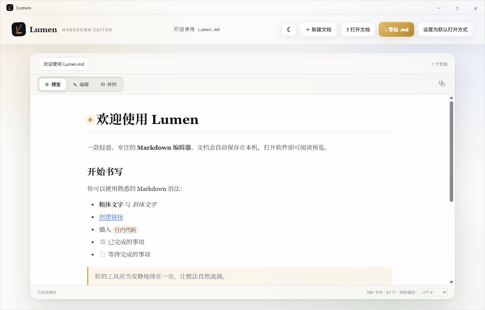
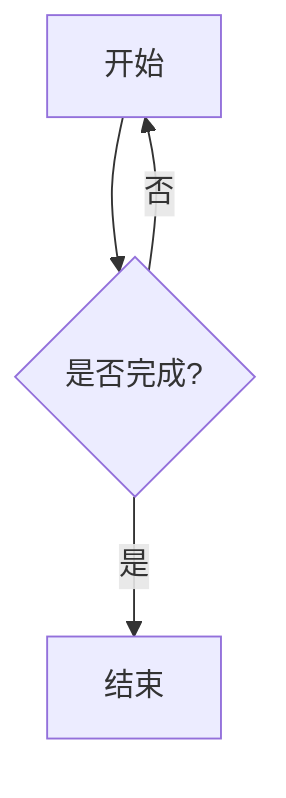

<div align="center">


# Lumen Markdown

**让想法自然流淌。**

一个轻量、专注、注重隐私的 Markdown 编辑器，支持实时预览与 Windows 桌面端使用。

<p>
  
  
  
</p>

</div>



## 产品理念

Lumen 的名字来自“微光”。它不是一个试图占据注意力的复杂工作台，而是一盏放在文字旁边的小灯：足够清晰，却不会打扰思考。

我们希望编辑器做到三件事：

- **安静**：让工具退后，让内容向前。
- **可靠**：打开、编辑、预览和导出都保持简单直接。
- **私密**：文档默认只保存在本地，不要求登录，也不主动上传内容。

## 功能亮点

- 新建空白文档，直接进入 Markdown 编辑器
- 多文档标签切换，每份文档独立保存内容、名称和编码，重启后恢复
- 启动软件默认打开预览页；打开已有文档进入预览，新建文档进入编辑
- Markdown 编辑与实时预览
- `flowchart` 代码块流程图预览
- Mermaid flowchart 预览
- 编辑、预览和并列模式切换；并列模式下左右滚动实时同步
- 粗体、斜体、标题、引用、行内代码和列表快捷工具栏
- 代码块、表格、任务列表、图片和链接等常用语法
- 图片工具栏插入，支持网络图片、嵌入图片以及桌面端的本地、相对路径和 `file://` 图片
- 支持有序列表和常用安全 HTML 标签
- 自动识别并渲染 `http://`、`https://`、`www.` 蓝色超链接
- 支持本地文件路径和相对路径链接，并使用系统默认应用打开
- UTF-8、GBK、GB18030、UTF-16 LE、UTF-16 BE 编码识别与切换
- 拖放或多选 `.md` / `.markdown` 文件，按顺序打开为独立文档
- 按当前编码导出 Markdown 文件
- 一键复制渲染后的 HTML
- Dawn Light / Midnight Glow 主题
- 自动保存、字符统计、行数统计和 Windows 文件关联

### Flowchart 语法

使用 `flowchart` 围栏代码块即可实时预览流程图：

```flowchart
st=>start: 开始
op=>operation: 处理内容
cond=>condition: 是否完成？
e=>end: 结束

st->op->cond
cond(yes)->e
cond(no)->op
```

也支持 Mermaid flowchart：



## 快速开始

### 开发运行

```bash
npm install
npm start
```

### 验证文档功能

```bash
npm test
```

验证会使用独立的临时数据目录和隐藏的 Electron 窗口，检查文档编辑、切换、持久保存、图片显示与启动预览。

### 构建 Windows 安装包

```bash
npm run dist
```

构建结果位于 `dist/`：

- `Lumen-1.0.0-setup-x64.exe`：安装程序
- `Lumen-1.0.0-portable-x64.exe`：免安装版本

安装程序支持 `.md` 和 `.markdown` 文件关联，也可以在 Windows“默认应用”设置中将 Lumen 设为默认打开方式。

## 使用小贴士

| 操作 | 说明 |
| --- | --- |
| `Ctrl + N` | 新建空白文档并进入编辑 |
| `Ctrl + O` | 选择并打开一个或多个文档 |
| `Ctrl + S` | 导出当前文档 |
| `Ctrl + B` | 粗体 |
| `Ctrl + I` | 斜体 |
| `Tab` | 在编辑器中插入两个空格 |
| 拖放多个文件 | 每个 Markdown 文件分别打开为一个标签 |
| 点击文档标签 | 切换查看或编辑文档，草稿分别自动保存 |
| 点击编辑工具栏的图片按钮 | 插入图片；桌面端记录本地路径，浏览器端嵌入不超过 2 MB 的图片 |
| 点击底部“读取编码” | 按所选编码重新读取文件 |
| 点击文档名称 | 重命名当前文档 |

桌面端的图片相对路径以所在 Markdown 文件的目录为基准，例如 ``。含空格的路径可以写成 ``。新建文档可通过图片按钮插入本地图片，或使用绝对路径；需要使用相对路径时，先导出并重新打开该 Markdown 文件。无法读取的图片会显示提示。

自动保存保留的是本机草稿；点击「导出 .md」将当前内容保存为 Markdown 文件。升级后的首次启动会保留旧版本的单文档草稿。

## 项目结构

```text
├── assets/       Logo、图标与 README 视觉资源
├── app.js        编辑器交互、Markdown 渲染与本地存储
├── index.html    应用界面
├── main.js       Electron 主进程、文件关联与系统打开方式
├── preload.js    主进程与渲染进程之间的安全桥接
├── styles.css    界面样式与主题
└── package.json  项目配置与构建脚本
```

## 隐私说明

Lumen 不要求登录，也不会主动上传文档内容。编辑内容默认通过浏览器 `localStorage` 保存在本机；导入、导出和本地文件打开均由当前设备完成。

## 许可证

当前项目尚未指定开源许可证。

<div align="center">

Made for focused writing · Lumen

</div>
